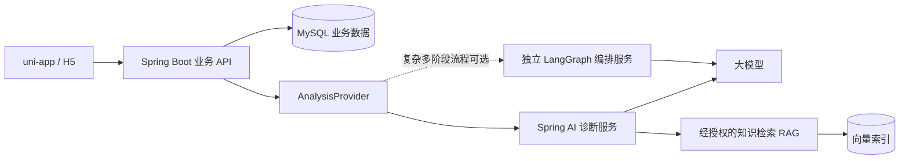

# AI 诊断接入与演进边界

当前仍是单机业务地基。`server/analysis.ts` 定义 `AnalysisProvider`；规则基线为 `RuleAnalysisProvider`，默认模型为 `qwen-plus-2025-12-01`（非思考模式），`server/bailian.ts` 新增真实模型适配器。`server/model-config.ts` 仅在服务端读取忽略的本机 YAML，`server/jobs.ts` 提供单并发、可取消的持久化诊断任务，`server/quota.ts` 负责按实际 Token 用量结算的本地周额度账本；未配置时继续规则模式。健康检查按配置返回真实引擎，但不检测供应商权限、余额或网络。

真实模型返回候选问题与缺失事实问题，服务端检查结构、长度、原文唯一定位、重叠及问题字段数字风险；建议保留原文并由服务端生成待补事实占位，不直接采用模型代写的经历；所有建议经用户核实后才能应用。参考分和关键词仍是透明规则，不是模型评分、ATS 通过率或招聘推荐。模型处理前须接受当次告知；默认遮盖邮箱、手机和身份证号，不能保证匿名化。固定模型配置、版本快照及输入 hash。当前使用本地词表检索随包的原创岗位参考卡。规则报告展示卡片与来源版本，百炼适配器可在启用后将固定的卡片作为生成上下文并校验引用。线上启用与真实质量验收需单独进行。向量数据库、Spring AI 和 LangGraph 属于后续生产演进设计。

## 推荐演进

Spring Boot 负责身份认证、授权、租户隔离、简历与版本、诊断任务、额度计费、审计和数据保留。前端继续使用 `/api/v1` 业务契约，不直接持有模型密钥。先将业务 API 从本地 JSON 迁移至 Spring Boot 与数据库，再通过诊断适配器接入模型，避免将业务权限写进提示词。

Spring AI 可以在 Java 服务内部统一模型调用、结构化输出、嵌入和向量检索。初期采用“提取事实 → 岗位对齐 → 问题诊断 → 受约束的改写 → 结果校验”固定流水线即可。需要可恢复的多阶段执行、追问分支或人工确认节点时，再将编排封装为独立的 LangGraph HTTP 服务；Spring Boot 仍持有业务权威数据。这个架构选择基于 Spring AI 的模型 / 向量存储抽象及 LangGraph 的有状态编排定位。[Spring AI 官方概览](https://docs.spring.io/spring-ai/reference/)、[LangGraph 官方概览](https://docs.langchain.com/oss/python/langgraph/overview)

无需同时引入 Spring AI、LangChain、LangGraph 作为相互嵌套的核心依赖。Java 团队可先采用 Spring AI；若选 Python 编排服务，LangGraph 可按需求独立使用，LangChain 只在模型 / 工具组件确有收益时引入。选择框架是实现决策，稳定的业务契约和诊断质量评估应先于框架数量。

## RAG 应检索什么

检索源优先为经过授权、版本清晰的岗位能力模型、行业术语、招聘要求和写作规范。知识入库应记录 `documentId / source / version / tenantId / updatedAt`，检索按租户和授权过滤，再向结果附带来源。私有简历与公共知识索引分离，其他用户简历不得成为未经授权的召回材料。Spring AI 官方 RAG 文档说明了检索增强生成的模块与组合方式，可作为后续具体实现入口。[Spring AI RAG 文档](https://docs.spring.io/spring-ai/reference/api/retrieval-augmented-generation.html)

RAG 用来补充有出处的岗位知识，不用来为用户推断公司、技能、职责或业绩。用户简历与 JD 是不可信内容，不能作为系统指令执行。诊断输出需引用对应的正文证据；缺失的事实返回澄清问题或 `[请填写真实…]`，不能自动捏造数字。采用修改之前始终经过用户核实，并检查版本、原文匹配和幂等标识。

## 接口与任务模型

当前 `AnalysisProvider.analyze({resume,jobDescription,targetRole,signal,metering})` 返回共享 `Analysis`；`metering` 是服务端派发和实际用量回调，不进入客户端领域契约。未来适配器可调用内部 `POST /internal/v1/diagnose`，携带租户鉴权、`resumeId / resumeRevision / requestId` 和经过必要脱敏的文本；模型服务返回结构化维度、证据、建议、引用及引擎版本。当前异步入口返回 202 与 `AnalysisJob`，任务状态为 `queued / running / completed / failed / cancelled`，完成后带 `analysisId`，客户端轮询获取报告。任务、固定快照、输入与工作流 hash、请求幂等标识保存在单进程 JSON 中；规则模式保留同步入口。进程重启保留任务 ID，并把未完成任务标为 `JOB_INTERRUPTED`，不自动重放模型请求。尚未发送的预占释放，已发送但用量未知的记录保持待核对，不能把本地恢复当作供应商免单。这仍不是多实例持久生产队列。

共享 schema 已扩展模型元数据，后续生产接入仍需完善 `engine` 联合类型、`model / promptVersion / workflowVersion / citations` 元数据与运行时验证器；拒绝无法定位原文、缺少事实依据或不符合 schema 的输出。应配置超时、取消、重试上限、幂等键、令牌 / 成本上限和规则回退，不能让模型失败导致原始简历丢失。

## Token 结算边界

真实模型派发前先持久化预占和发送意图。适配器取得供应商响应后，在输出内容校验之前验证并记录 `prompt_tokens / completion_tokens / total_tokens`；三者须为非负安全整数且总量相符。单条实际用量只结算一次，供应商请求标识不能重复关联多个任务。计量失败不重试模型；本地账本写入可幂等重试。已产生的有效用量不因建议校验失败、保存失败或取消而撤销。

请求已发出但响应未完整取得、没有有效 `usage` 或进程中断时，保留未知状态，不用字符数估算正式扣减，也不自动释放；该用户后续模型调用被阻止，等待可信供应商证据核对。输入字节上界及最大输出只用于保守预占。前端只读取剩余百分比、刷新/到期时刻和待核对标志，不显示单次消耗或绝对 Token。初级和高级目前分别采用每周 200,000、800,000 Token 的后台试运行配置；没有可信会员记录时保持原演示预览，不生成付费身份。详见 [AI 周额度与线下核对](ai-quota.md)。

## 上线验收

建立经脱敏和授权的简历 / JD 评估集，覆盖应届、转行、资深和非技术岗位。比较建议的事实一致性、证据覆盖、岗位相关性、修改可接受率、延迟与成本；把“编造业绩”和“跨租户泄漏”设为阻断项。评分需要清晰的维度与版本，模型分数不能包装成真实 ATS 结果或录用概率。上线时另行完成认证、权限、数据库迁移、对象存储、文件扫描与解析、限流、隐私删除及审计。
